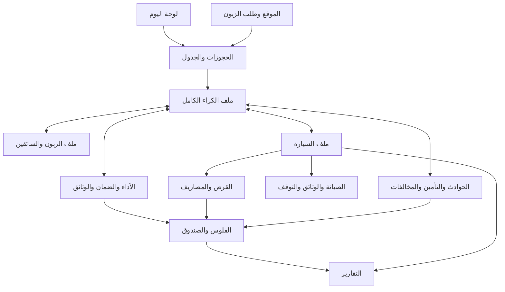

# خريطة شاشات نظام تسيير الوكالة

هاد الخريطة كتفصل [المرجع الموحّد](master-specification-ar.md) لشاشات قابلة للتصميم والبناء. المرجع الموحّد كيبقى صاحب قواعد العمل؛ هنا كنحددو فين كتعيش كل معلومة، منين كتفتح، وشنو يقدر المستخدم يدير بها. ترتيب الصفحات والتبويبات اقتراح تصميم، ما كيبدلش الأثمنة ولا الصلاحيات ولا القرارات اللي باقية للحسم.

النطاق هو النسخة الأولى كاملة لوكالة واحدة، مع الموظفين والمسؤول. الأسماء بالعربية للشرح؛ لوحة التسيير الفعلية بالفرنسية، والموقع ومسار الزبون بالعربية والفرنسية. ما كاين لا كود تطبيق ولا ترحيل بيانات فهاد المرحلة.

## طريقة قراءة الخريطة

**صفحة:** عندها عنوان ورابط، يمكن تخرج منها وترجع ليها مباشرة. **تبويب:** جزء من ملف واحد، يحتافظ بسياقه ويمكن يكون عنده رابط مباشر. **إجراء:** نموذج قصير أو مسار داخل الملف، ما يحتاجش مدخلاً مستقلاً فالقائمة. **عرض مفلتر:** نفس اللائحة، مثلاً الحجوزات المؤكدة أو الأقساط المتأخرة، ماشي مصدر بيانات آخر.

المعرفات بحال «ك١» كتساعد نربط التغطية بالشاشات؛ ما غاديش تبان للموظف. كل ما هو داخل الأقسام المفصلة أدناه فالنسخة الأولى، باستثناء العناصر المعلّمة مؤجلة أو معلقة للحسم.

## القائمة الرئيسية

| المدخل | شنو كيتجمع فيه | نوع الوصول |
|---|---|---|
| اليوم | العمل العاجل، التسليم والرجوع، الطلبات والتنبيهات | الموظف حسب خدمته؛ المسؤول يزيد المالية |
| الحجوزات والكراء | الطلبات، الجدول، جميع الملفات، إنشاء كراء | الموظف والمسؤول؛ الإجراءات حسب الصلاحية |
| السيارات | الملفات، التوفر، الصيانة، الوثائق والتوقفات | التشغيل للموظف؛ التمويل والنتائج للمسؤول |
| الزبناء | الأشخاص، السائقون، الوثائق وتاريخ التعامل | حسب صلاحية الوصول للمعلومات والملفات |
| الفلوس | الأداءات، الضمانات، الإرجاعات، المصاريف، القروض والصندوق | المالية العامة للمسؤول؛ عمل الموظف من ملف الكراء |
| الملفات والمتابعة | الحوادث، التأمين، المخالفات والخلافات | حسب الملف والإجراء؛ اعتماد المال للمسؤول |
| التقارير | الوكالة والسيارات والتحصيل والتوقف | المسؤول |
| الإعدادات | الوكالة، الأسعار، الشروط، الموقع، الحسابات والصلاحيات | المسؤول |

الصيانة والتمويل موجودان فالقائمة تحت المجال المناسب، وعندهما روابط من ملف السيارة. ما نجمعوش الأقساط والصيانة والتأمين فتبويب مبهم اسمه «معلومات أخرى».

هاد الرسم كيبين الروابط الرئيسية فقط؛ الجداول التالية هي الجرد الكامل للشاشات والتبويبات والإجراءات.

## الدخول والأدوات المشتركة

هاد شاشات مساندة مقترحة باش الخدمة تكون قابلة للاستعمال، ماشي وحدات تجارية جديدة.

| المعرف والشاشة | المحتوى والإجراءات | القاعدة |
|---|---|---|
| ع١ الدخول واسترجاع الولوج | دخول، نسيان كلمة المرور، تعيين كلمة بعد إنشاء الحساب، رسالة جلسة منتهية أو حساب معطل | حساب فردي؛ لا إنشاء حساب وكالة ذاتياً فالنسخة الأولى |
| ع٢ الحساب الشخصي | الاسم، تغيير كلمة المرور، الخروج | الموظف ما يبدلش دوره أو صلاحياته |
| ع٣ البحث العام | البحث بمرجع الكراء أو الاسم أو الهاتف أو لوحة السيارة؛ نتائج مجمعة حسب النوع | ما يكشفش نتيجة أو معلومة خارج صلاحية المستخدم |
| ع٤ مركز التنبيهات | موعد، سبب، درجة الاستعجال، الملف المرتبط، والخطوة المطلوبة؛ تصفية غير المعالج | قراءة التنبيه ما تحلش سببه؛ كتفتح التبويب أو الإجراء المعني مباشرة |
| ع٥ عارض الوثيقة الخاصة | معاينة، نوع الملف، صاحبه، الإصدار، تاريخ الرفع والتحقق، وتنزيل إذا مسموح | نفس العارض من الزبون والسيارة والكراء والحادث، بوصول مراقب |
| ع٦ حالات الوصول والأخطاء | غير مسموح، ملف غير موجود، رابط منتهٍ، فشل الشبكة، تعارض تحديث | الرجوع لمسار مفيد؛ ما نبينوش بيانات ملف ممنوع |

فكل لائحة: بحث مناسب، فلاتر، ترتيب، عدد النتائج وصفحات، ورسالة واضحة إلا ما كاين حتى عنصر. الرجوع من ملف يحتافظ بالفلاتر والموضع. فكل نموذج: النواقص بجانب الحقول، حالة حفظ واضحة، وتنبيه قبل مغادرة تعديل غير محفوظ. حفظ مسودة ما يساويش تأكيد إجراء مالي أو تغيير مرحلة.

## لوحة اليوم

**ي١ صفحة العمل اليومية** كتجاوب على «شنو خاصني ندير دابا؟». ما تعوضش التقارير، وما تحتاجش تعرض كل معلومات الوكالة دفعة واحدة.

| العرض داخل اليوم | شنو كيبان | فين كيوصل الضغط |
|---|---|---|
| الطلبات الجديدة ومحاولات الاتصال | الزبون، السيارة، المواعيد، الإجمالي، آخر تواصل | ك٢ ثم ملخص ك٤ أو التواصل ك٤ح |
| انتظار التحويل | المبلغ المطلوب، المتحقق منه، المهلة، وجود إثبات | الأداء داخل ك٤د |
| الخيارات القريبة من الانتهاء | موعد الانتهاء وما ينقص التأكيد | نفس الكراء؛ تمديد المهلة للمسؤول فقط |
| التسليم اليوم والقادم | السيارة والزبون والوقت والنواقص بالأسماء | فحص وشروط التسليم ك٥ |
| الرجوع اليوم والمتأخر | موعد متوقع، تأخر، الحجز الموالي المهدد | الرجوع ك٦ أو معالجة التعارض ك٧ |
| سيارات غير جاهزة | تحضير، عطب، حادث، مدة معلومة أو مجهولة | س٦ مع مصدر التوقف |
| وثائق وصيانة مستحقة | نوع الوثيقة أو أساس الصيانة بالتاريخ والعداد | س٤ أو س٥ |
| تجديد كراء قريب | نهاية الفترة، الرصيد، وجود حجز لاحق | تمديد ك٧، بلا تجديد آلي |
| متابعة حادث أو تأمين أو مخالفة | آخر إجراء، المقبل، الموعد والملف | م٢ أو م٤ أو م٥ |
| للمسؤول فقط | أقساط ومصاريف مستحقة، إرجاعات وضمانات معلقة، فرق صندوق، تحصيل تأمين | ف٢ أو ف٣ أو ف٤ أو ف٥ أو ف٦ أو م٣ |

مجاميع اليوم كتوضح شنو داخل فيها والفترة ديالها. الموظف ما كيشوفش مجموع مالية الوكالة. التنبيهات الحساسة ما تخرجش ليه حتى فعداد أو عنوان إشعار.

## الحجوزات والكراء

### اللوائح والجدول والإنشاء

| المعرف والشاشة | المحتوى | الإجراءات والروابط |
|---|---|---|
| ك١ جميع ملفات الكراء | المرجع، الزبون، السيارة، الفترة، المصدر، مرحلة الكراء، حالة التسوية والنواقص؛ تصفية اليوم أو المدة أو الحالة | فتح ك٤، إنشاء ك٣، الانتقال للجدول؛ الملغى والراجع يبقاو قابلين للبحث |
| ك٢ طلبات الموقع | عرض من ك١ فيه الطلبات الجديدة، الاتصال، انتظار الأداء، انتهاء المهلة؛ الفرز حسب الوقت والحاجة للتدخل | فتح نفس ك٤، تسجيل الاتصال، تفعيل خيار، معالجة طلب مهمل وفق القاعدة اللي غادي تتحسم |
| ك٣ كراء جديد من الوكالة | البحث عن زبون موجود أو إنشاؤه، السائقون، المواعيد واللغة، السيارة المتاحة، تفصيل الثمن والحصة والضمان | حفظ مسودة أو خيار، تسجيل الأداء ثم التأكيد إذا الشروط مكتملة؛ بلا اتصال إجباري |
| ك٧ الجدول والتوفر | عرض فترة لسيارات مختارة، الحجوزات والتوقفات والتحضير، الوقت المتوقع والفعلي، تنبيه التأخر | فتح الكراء أو التوقف، إنشاء كراء للفترة، اقتراح تعديل أو بديل؛ عرض قائمة للهاتف |

«طلبات الموقع» و«المؤكدة» و«الجارية» و«الراجعة وباقي عليها رصيد» فلاتر لنفس السجلات. انتقال الطلب للتأكيد ما ينشئش نسخة ثانية منه. نفس الكراء يتفتح من اليوم أو السيارة أو الزبون أو المال بنفس المرجع.

### ك٤ ملف الكراء الكامل

هاد هو الملف اللي غادي نصمموه فالخطوة المقبلة. كيبدأ من طلب أو كراء مباشر، وكيستمر حتى الرجوع والتسويات اللاحقة؛ ما كيساليش عند تأكيد التحويل.

**أعلى الملف دائماً:** المرجع والمصدر، الزبون والسائق الرئيسي، السيارة الحالية، المواعيد، مرحلة الكراء، الإجراء التالي، والنواقص. الحالة المالية وحالة الضمان وجاهزية السيارة ظاهرة كل واحدة بمعناها. «راجع» ما تعنيش «مسوّى»، و«مؤكد» ما تعنيش «خرج».

| التبويب | المحتوى اللي خاصو يكون | الإجراءات والروابط |
|---|---|---|
| ك٤أ الملخص | الاتفاق الحالي، المدة، وقت انتهاء الخيار، آخر اتصال، المستحق والمحصل والباقي، الضمان، شروط التسليم الناقصة والمتابعات المفتوحة | الانتقال مباشرة للجزء الناقص؛ الإجراء الرئيسي حسب المرحلة، والإجراءات الاستثنائية فقائمة واضحة |
| ك٤ب الزبون والسائقون | صاحب العقد والسائقون، لغة الزبون، التواصل، الهوية والرخصة وصلاحيتها وحالة التحقق | فتح ز٢، ربط شخص موجود أو إضافة سائق، إرفاق الوثيقة والتحقق ضمن الصلاحية؛ لا إعادة كتابة ملف الشخص لكل كراء |
| ك٤ج السيارة والاتفاق | الوحدة الحالية والسابقة، الفترة، مكان التسليم، المدة، الأسعار حسب المواسم، نصف اليوم، الحصة وتعريفة التجاوز، نسخة الشروط | فتح س٢، معاينة الثمن؛ التغيير بعد التأكيد عبر تعديل موثق فقط؛ روابط التمديد والتبديل |
| ك٤د الأداء والضمان | منطقتان منفصلتان: مستحقات الكراء وأداءاته وإرجاعاته؛ ثم مبلغ الضمان وطريقته وحركاته ورصيده | قبض جزئي أو كامل، إثبات تحويل والتحقق، تخصيص مبلغ، اعتماد/تنفيذ إرجاع، تحديد الضمان واستلامه أو إعفاؤه، اقتطاع أو رد معتمد؛ سجل كل عملية |
| ك٤هـ التسليم والرجوع | شروط الخروج، الفحص والصور والأضرار السابقة، العداد والوقود، التوقيت الفعلي، الفحوص عند التبديل، مقارنة الرجوع | فتح مسار ك٥ أو ك٦؛ عرض محاضر الفحص؛ تسجيل ضرر يفتح م٢ بنفس السياق |
| ك٤و التعديلات | طلبات التمديد، التجديد، تغيير الموعد أو السيارة، التخفيضات والتصحيحات والإلغاء؛ السابق والجديد والسبب والفرق | معاينة أثر التعديل والتوفر وموافقة الزبون والاعتماد المناسب؛ رفض التغيير يبقي الأصل |
| ك٤ز العقود والفواتير | عروض محفوظة، عقد صادر، نسخة موقعة، ملحق تمديد أو تبديل، فاتورة وتصحيحها، حالة إصدار الملفات | معاينة وطباعة وتنزيل الأصل، إرفاق الموقّع بالإصدار الصحيح، إعادة محاولة الإصدار؛ لا إعادة توليد تمسح الأصل |
| ك٤ح المتابعة والتاريخ | الاتصالات، الرسائل اليدوية، الوقائع والقرارات ومَن قام بها، روابط الحوادث والمخالفات والنزاعات والتحصيل | تسجيل نتيجة اتصال وموعد متابعة، تحضير رابط رسالة بلغة الزبون، تأكيد إرسال يدوي، فتح الملف المرتبط؛ لا ادعاء قراءة أو تسليم الرسالة |

فالهاتف كيبان الملخص والإجراء والنواقص أولاً، والتنقل بين هاد الأقسام يبقى واضحاً. الاختصار فالعرض ما يحيدش إمكانية الوصول لأي وظيفة.

### إجراءات داخل ملف الكراء

| الإجراء | المعلومات اللي يطلب أو يعرض | النتيجة وموانعها |
|---|---|---|
| تفعيل أو تمديد الحجز المؤقت | السيارة والفترة والعرض، الموعد النهائي؛ سبب وموعد جديد عند تمديد المسؤول | فحص التوفر وحفظ المهلة؛ الطلب وحده غير مانع |
| تسجيل مبلغ أو إثبات | المبلغ، الطريقة، التاريخ، الحساب/الصندوق، المرجع والمرفق | الإثبات وحده يبقى غير متحقق؛ كامل المبلغ شرط التأكيد |
| التحقق والتأكيد | الأموال المتوصل بها والتخصيص والتوفر والمهلة | إذا فشل التخصيص، المال يبقى مسجلاً مع معالجة مطلوبة؛ لا تأكيد كاذب |
| تعديل المواعيد قبل التسليم | الفترة القديمة والجديدة، أثر الثمن والتوفر، موافقة الزبون | لا إعادة كتابة الاتفاق المجمد؛ تحفظ نسخة/تسوية مرتبطة |
| تمديد أو تجديد | فترة جديدة بنهاية معلومة، سعرها وحصتها، التوفر والأداء | لا تمديد فوق حجز آخر، ولا تجديد أو قبض آلي؛ تنبيه قبل النهاية بيومين |
| تبديل السيارة | البديلة، فترة استعمال الأولى والثانية، السبب، الفحصان، فرق الثمن والحصة | نفس الكراء؛ سجل تخصيص جديد، لا تكرار أيام أو كيلومترات |
| إلغاء أو عدم حضور | السبب والوقت والسياسة المجمدة، مستحق الإلغاء، المبلغ الواجب رده | تحرير الإشغال حسب الحالة، تسوية المستحق ثم تتبع تنفيذ الإرجاع |
| رجوع مبكر | الوقت الحقيقي، السبب، الخدمة غير المستعملة والاتفاق | لا إرجاع تلقائي لمجرد الرجوع المبكر؛ تسوية موثقة عند استحقاقها |
| تصحيح أو إعفاء مالي | البند الأصلي، المبلغ الجديد/التسوية، السبب والاعتماد | بند تصحيح مرتبط، بلا حذف الأداء أو تغيير السعر القديم |
| تسوية خلاف أو ضرر | الأدلة، المسؤولية، المبلغ المعتمد والمختلف عليه، مصدر التحصيل | قرار المسؤول مستقل عن مجرد تسجيل الموظف للواقعة |

صلاحية تسجيل التحويل ما كتثبتش تلقائياً صلاحية التحقق منه. مَن ينفذ الإرجاع المعتمد باقي داخل مصفوفة الصلاحيات اللي خاصها حسم.

### ك٥ مسار تسليم السيارة

مسار مخصص داخل الكراء، قابل للحفظ والرجوع، ومربوط بالفحص الأصلي:

١. مراجعة الزبون والسائقين وصلاحية الهوية والرخص والتحقق من الأصول.

٢. مراجعة الرصيد والضمان: كامل الأداء، ضمان مستلم/محجوز بالطريقة الفعلية أو إعفاء معتمد. النقص يظهر بالاسم.

٣. مراجعة السيارة: رجوع فعلي من الكراء السابق، جاهزية، وثائق صالحة، لا توقف مانع.

٤. فحص الخروج: الوقت والعداد والوقود، صور وأضرار سابقة وملاحظات ومراجعة السائق.

٥. العقد: الإصدار الصحيح، طباعة، توقيع يدوي ونسخة واضحة مرفقة، وتأكيد التحقق.

٦. ملخص ومراجعة أخيرة ثم تأكيد التسليم الفعلي. لا زر خروج ناجح مع شرط ناقص، ولا تجاوز لمانع سلامة.

### ك٦ مسار رجوع السيارة

١. تسجيل الوقت الحقيقي والعداد والوقود والصور ومقارنة فحص الخروج. يمكن حفظ الرجوع ولو بقى نزاع أو دين.

٢. عرض التأخير والمسافة الزائدة والأضرار المحتملة، مع تمييز المقترح عن المستحق المعتمد. ضرر قديم ما يعاودش يتحسب.

٣. إن وُجد حادث: فتح/ربط م٢، وتسجيل التوقف المحتاج للإصلاح، بلا تكرار فاتورة الإصلاح.

٤. تسوية الكراء والضمان: ما يرجع، ما اقتطع باعتماد، ما بقي موثقاً للمراجعة، ومن نفذ الحركة ومتى.

٥. وضع السيارة: تحضير أو توقف بسبب، ثم تأكيد الجاهزية عند استيفائها. نهاية وقت تقديري ما ترفعش عطباً تلقائياً.

٦. إصدار الوثائق المناسبة وعرض المتابعات اللي مازال مفتوحة. يمكن النتيجة تكون: سيارة راجعة وجاهزة، زبون مسوّى، وتأمين باقٍ للتحصيل.

## الزبناء والسائقون

| المعرف والشاشة | المعلومات والتبويبات | الإجراءات والروابط |
|---|---|---|
| ز١ لائحة الزبناء | الاسم، الهاتف، التعريف المناسب، نواقص الوثائق، بحث ومنع التكرار | إضافة شخص أو فتح ز٢ أو بدء ك٣ بزبون محدد |
| ز٢ ملف الشخص | الهوية والتواصل والعنوان واللغة؛ الهوية والرخصة وملفاتهما وصلاحيتهما؛ تاريخ كراءاته كصاحب عقد أو سائق؛ ملاحظات موثقة | تعديل بيانات حالية، رفع/استبدال وثيقة مع تاريخها، تحقق من الأصل، فتح كراء أو متابعة مرتبطة |
| ز٣ إضافة أو تعديل شخص | الحقول المطلوبة حسب نوع الوثيقة وصاحب العقد/السائق، اقتراح مطابقات محتملة | مراجعة التشابه قبل الإنشاء؛ الهاتف المشترك ما يدمجش أشخاصاً آلياً |
| ز٤ مراجعة منع أو رفع منع | سبب، قرار، صاحب القرار والتاريخ، روابط الوقائع | إجراء مضبوط الصلاحية؛ خلاف واحد ما يساويش منعاً تلقائياً |

التاريخ المالي هنا خاص بالملفات المسموح الوصول ليها؛ ما يعطيش للموظف تقارير عامة. صاحب العقد والسائق ماشي دائماً نفس الشخص. النسخة المجمدة فالعقد القديم تبقى مستقلة عن آخر تعديل فالملف.

## السيارات والتوفر والصيانة

| المعرف والشاشة | المحتوى | الإجراءات والروابط |
|---|---|---|
| س١ لائحة السيارات | الصورة والاسم واللوحة، الحالة الحالية، الحجز المقبل، الوثائق أو الصيانة المستحقة؛ بحث وتصفيات | فتح س٢، إضافة س٣، فتح الجدول ك٧؛ المالية العامة ما تظهرش للموظف |
| س٢ ملف السيارة | التبويبات المبينة أسفله | كل سجل كيحافظ على أصله، ما نعاودوش نسجلو قرضاً أو مصروفاً من أجل عرضه هنا |
| س٣ إنشاء وتعديل السيارة | الهوية واللوحة والهيكل، الطراز والسنة والوقود وعلبة السرعات والمقاعد والأبواب والتجهيزات والعداد الأولي | حفظ ملف واحد؛ استكمال الوثائق والنشر والتمويل من داخله |
| س٤ الوثائق والمواعيد | لائحة مجمعة لتأمين السيارات والفحص التقني وباقي الوثائق، الصلاحية والإصدارات | فتح الوثيقة والسيارة، تسجيل تجديد وتواريخ ومرفقات؛ ربط مصروفه بف٤ |
| س٥ الصيانة | مستحقة بالتاريخ/العداد، مخططة، جارية ومنجزة؛ آخر قراءة وتاريخها | إنشاء تدخل، موعد ومرأب وأشغال، تسجيل الإنجاز والعداد والموعد المقبل، ربط المصروف والتوقف |
| س٦ التوقفات والجاهزية | صيانة، حادث، تحضير؛ مخطط وفعلي، سبب، نهاية معلومة أو مجهولة، حجوزات مهددة | بدء/تعديل توقف، مراجعة أثره، رفع المانع بعد تحقق الجاهزية حسب الصلاحية |

**تبويبات س٢:**

| التبويب | المحتوى والإجراءات |
|---|---|
| الملخص | الهوية والحالة والعداد والتنبيه الأهم والكراء الحالي والمقبل |
| الحجوزات والاستعمال | الجدول والتخصيصات والفحوص والزبناء عبر الكراء، مع روابط ك٤ |
| العداد والفحوص | سجل القراءات ومصدرها وتاريخها؛ تصحيح موثق أو تبديل عداد، لا تخفيض صامت |
| الوثائق | تأمين وفحص تقني ووثائق السيارة وإصداراتها؛ روابط س٤ والعارض ع٥ |
| الصيانة والتوقف | نفس تدخلات س٥ وتوقفات س٦، مع تكلفة مرتبطة بالمصروف الأصلي |
| الحوادث والمتابعة | الحوادث والمطالبات والمخالفات والتوقف المرتبط، بروابط م٢ وم٤ |
| التمويل والمصاريف | عقد القرض وجدوله، الأقساط والمصاريف المباشرة؛ للمسؤول وروابط ف٤ وف٥ |
| النتائج | دخل الفترة والمحصل والمصاريف والأقساط والتوقف؛ نفس تقرير ت٢، للمسؤول |
| العرض فالموقع | عنوان ووصف باللغتين، صور تسويقية وغلاف، تجهيزات، السعر من مصدره، معاينة اللغتين، نشر/إخفاء |

النشر من تبويب الموقع هو نشر السيارة نفسها، ماشي إنشاء سيارة أخرى. صور الحالة واللوحة والوثائق والقرض والحوادث خاصة. عدم اكتمال المحتوى المطلوب باللغتين يظهر قبل النشر. الميزة بحال بلوتوث أو كاميرا مجرد تجهيز موصوف، ما كتزيدش رسماً تلقائياً.

## الفلوس

هاد القسم كيقدم الرؤية العامة للمسؤول. الموظف كينفذ ما سُمح له من داخل ملف الكراء أو نموذج مصروف للمراجعة، بلا ما نفتح ليه مجاميع الوكالة.

| المعرف والشاشة | المحتوى | الإجراءات والروابط |
|---|---|---|
| ف١ الأداءات والتحصيل | المقبوض المتحقق، تحويلات معلقة، تخصيصاتها، المبالغ الزائدة أو غير المخصصة، المرجع والطريقة والحساب | فتح العملية وأصلها ك٤ أو م٢؛ تسجيل/تحقق حسب الصلاحية؛ لا تعديل مباشر لرصيد مشتق |
| ف٢ الضمانات | المستلم، المردود، المستعمل، المتبقي والمختلف عليه، الكراء والزبون | فتح ضمان ك٤د؛ تحديد/استلام/إعفاء/اقتطاع/رد حسب الصلاحية؛ لا خلط بدخل الكراء |
| ف٣ الإرجاعات والتسويات | المستحق رده، المعتمد، المنفذ جزئياً/كلياً، والسبب والأصل | اعتماد المسؤول ثم توثيق التنفيذ والمرجع؛ إرجاع كراء وإرجاع ضمان نوعان واضحان |
| ف٤ المصاريف | سيارة أو وكالة، مورد/جهة، نوع ووثيقة واستحقاق، مجموع ومؤدى وباقٍ | إنشاء مصروف، بنود وتوزيع فاتورة مشتركة، أداء جزئي/كامل، تصحيح موثق؛ فتح السيارة/الصيانة/الحادث |
| ف٥ التمويل والأقساط | لائحة القروض والاستحقاقات والمتأخر؛ ملف قرض وجدول فعلي لكل سيارة | إدخال العقد، توليد جدول للمراجعة أو إدخاله، تعديل موثق، تخصيص أداء لقسط أو عدة أقساط |
| ف٦ الصندوق والحسابات | حركات نقد/بنك، مصدر كل قبض وصرف، المتوقع والمعدود والإقفالات والفروق | عرض الحركة وأصلها، إقفال نقدي وتسليم مسؤولية ومراجعة الفرق حسب الصلاحية |
| ف٧ الفواتير والوثائق المالية | الأرقام والزبون والكراء والإصدار والمبلغ والتصحيحات وحالة الملف | فتح الأصل أو نسخة التصحيح، طباعة وتنزيل حسب الصلاحية، إعادة محاولة إصدار فاشل؛ الوصول من ك٤ز لنفس السجل |

**داخل ملف المصروف:** الجهة والوثيقة، البنود، توزيعها على السيارات/الوكالة، الاستحقاق، الأداءات والتاريخ. التسجيل ما يعنيش الأداء. جهات الأداء بيانات مساعدة؛ ما نضيفوش وحدة مشتريات ومخزون كاملة.

**داخل ملف القرض:** السيارة والجهة والعقد، جدول بمبالغ ومواعيد قابلة للاختلاف، المطلوب والمؤدى والمتبقي، مرجع كل أداء، تاريخ تعديل الجدول. «مجموع الأقساط المتبقية» ما يتسمّاش أصل الدين إلا كانت بيانات أصل الدين معروفة. ما نحسبوش فوائد غير موجودة فالعقد.

**داخل إقفال الصندوق:** رصيد البداية والحركات النقدية والمتوقع والمعدود والفرق، ملاحظات ومن سلّم ومن تسلم ومراجعة المسؤول. مبلغ فرق ما يتحولش آلياً لمصروف وهمي. طريقة تسجيل الأرصدة الأولية والمراجعات كتتفصل قبل تنفيذ هاد الشاشة؛ الخريطة ما كتمنحش صلاحية تعديل الرصيد.

## الحوادث والتأمين والمخالفات والمتابعة

| المعرف والشاشة | المحتوى | الإجراءات والروابط |
|---|---|---|
| م١ لائحة الحوادث والتأمين | السيارة والكراء، الواقعة، حالة الإصلاح، تسوية الزبون، مطالبة التأمين والموعد المقبل | إنشاء ملف أو فتح م٢، تصفية غير المحصل أو السيارة المتوقفة |
| م٢ ملف الحادث | واقعة وأطراف وأدلة، مسؤولية وقرار، إصلاح ومصاريف، توقف، مستحق الزبون، مطالبات التأمين، تواصل وتاريخ | تبويبات مفصلة أدناه؛ الربط بكراء موجود أو حادث خارج كراء |
| م٣ تحصيل التأمين | عرض من نفس المطالبات: مطلوب، معتمد أو لم يحدد بعد، محصل، باقٍ معتمد، فرق/رفض ومتابعة | فتح م٢، تسجيل اتصال ووثيقة قرار، تسجيل قبض جزئي/كامل مرة واحدة |
| م٤ المخالفات | اللائحة والملف: وقت الواقعة، السيارة، إشعار، الكراء المقترح والسائق، المبلغ والاعتراض والأداء والتحصيل | مراجعة الربط، تسجيل المستند والقرار والأداء والتحصيل؛ لا دين آلي من وصول الإشعار |
| م٥ المتابعات والخلافات | عرض مجمع لمواعيد وإجراءات مرتبطة بكراء أو حادث أو مخالفة؛ سبب ومبلغ معتمد/متنازع عليه وآخر إجراء | فتح الأصل، إضافة ملاحظة وموعد، معالجة السبب؛ ماشي نظام محاسبة أو تذاكر منفصل يكرر الملف |

**داخل م٢:**

١. **الواقعة والأدلة:** تاريخ ومكان ووصف، السيارة والكراء، صور ومحضر وخبرة ومستندات مرتبطة.

٢. **المسؤولية وقرار الزبون:** غير محسومة/زبون/طرف آخر/مشتركة/نزاع، الوثيقة الداعمة، صاحب القرار، المستحق المعتمد وما بقي مختلفاً عليه؛ تعديل القرار يحتافظ بالتاريخ.

٣. **الإصلاح والتوقف:** المرأب، الأشغال، موعد فعلي ومتوقع، رابط المصروف الأصلي ف٤، جاهزية السيارة س٦. قبض التأمين ماشي شرط الجاهزية.

٤. **تسوية الزبون والضمان:** مستحق الضرر، ما خلصه، ما استعمل من الضمان، وما يرجع؛ روابط ك٤د. الزبون يمكن يتسوّى والتأمين يبقى مفتوحاً.

٥. **التأمين:** الشركة ومرجع المطالبة، المطلوب، قرار ومبلغ الموافقة إذا معروف، المقبوض والباقي، أسباب الرفض والوثائق. رفض جزء ما يخلقش ديناً على الزبون آلياً.

٦. **المتابعة والتاريخ:** الاتصالات والمواعيد والوثائق والأحداث، موعد الإجراء المقبل وإغلاق كل مسار بعد استيفائه.

فاتورة المرأب وقبض التأمين وحركة الضمان كيظهر كل واحد فعدة مواضع بروابط، ولكن كيتسجل مرة واحدة فمصدره.

## التقارير

| المعرف والشاشة | شنو كتقيس | الروابط والحدود |
|---|---|---|
| ت١ ملخص الوكالة حسب الفترة | مقابل الكراء للفترة، المقبوض، الباقي، المصاريف، الأقساط، تعويضات التأمين والالتزامات بالرد | كل رقم يفتح لائحة مصادره؛ الفصل بين الفترة التشغيلية وتاريخ حركة المال |
| ت٢ مقارنة السيارات وتفصيل سيارة | أيام الكراء والتوقف، المسافة، مقابل الكراء، المحصل، المصاريف المباشرة، الأقساط والتعويضات منفصلة | يفتح س٢ وك٤ وف٤ وف٥ وم٢؛ لا تنقيط آلي ولا «ربح صافٍ» بلا معالجة كاملة |
| ت٣ التحصيل والالتزامات | مبالغ متبقية، تحويلات معلقة، إرجاعات وضمانات واجبة الرد، مطالبات تأمين | عروض مالية من نفس ف١ وف٢ وف٣ وم٣، ماشي حسابات مكررة |
| ت٤ الاستعمال والتوقف | الكراء الفعلي، المدة الموقوفة وأسبابها، الصيانة والتأخر حسب فترة | يفتح فترات الاستعمال والتوقف؛ إذا حُسبت نسبة، المقام والفترة واضحان |

المصاريف العامة منفصلة عن السيارة ما لم تعتمد قاعدة توزيع. الكراء العابر للشهور أو التبديل بين السيارات، والتأمين السنوي، يحتاجو قواعد التوزيع المذكورة فالمرجع قبل اعتماد أرقام المقارنة. التصدير ما يتنفذش قبل تحديد صلاحية الوصول ونطاق البيانات.

## الإعدادات

| المعرف والشاشة | المحتوى | الحدود |
|---|---|---|
| ض١ هوية الوكالة والتواصل | الاسم والشعار والعنوان والتواصل ومعلومات العقد والفوترة ومعلومات التحويل المعتمدة | مراجعة البيانات القانونية والضريبية مع صاحبها؛ لا نسخ بيانات شركة العقد النموذجي |
| ض٢ الأثمنة والمواسم | السعر الأساسي، فترات المواسم، نطاق تطبيق السعر حسب القرار النهائي، معاينة المدة ونصف اليوم | يمنع التعارض غير المحسوم؛ لا تعديل اتفاق مؤكد بأثر رجعي |
| ض٣ قواعد الكراء | مدة التحضير والخيار، الكيلومترات وتعريفة التجاوز، التأخير والإلغاء وشروط الضمان والنسخ المعتمدة | القيم والسياسات غير المحسومة لا تتحول لإعداد نهائي من عندنا؛ لا مبلغ ضمان موحد مفروض |
| ض٤ المستخدمون والوصول | لائحة الحسابات، إضافة/تعطيل موظف، دور مسؤول أو موظف، عرض الصلاحيات المعتمدة | بلا محرر أدوار معقد أو صلاحيات جديدة ضمنية؛ التعطيل يحافظ على تاريخ الفاعل |
| ض٥ الموقع واللغات | هوية الموقع، معلومات التواصل والمحتوى العام باللغتين، معاينة وشروط وخصوصية | نشر السيارة من س٢؛ بلا محرر مواقع عام أو ترجمة ناقصة مخفية |
| ض٦ الحسابات وبيانات المال | حسابات البنك والصندوق، طرق الأداء الفعلية والتصنيفات اللازمة للمصاريف | إنشاء حساب ما يعطيش صلاحية تعديل أرصدته؛ لا ربط بنكي آلي |
| ض٧ الوثائق والشروط | بيانات وقوالب معتمدة للعقد والفاتورة والملحقات، اللغة والسلسلة والترقيم | معاينة وإصدارات؛ بلا محرر تصميم عقود حر، ولا إعادة ترقيم الماضي |
| ض٨ سجل القرارات الحساسة | مَن ومتى وما تغير والسبب والملف | قراءة وتصفية للمصرح له؛ لا تعديل أو حذف حتى للمسؤول |

سياسة حفظ الوثائق الخاصة والوصول ليها كتتحدد قبل جمعها فعلياً. ما نوفرّوش زر «حذف جميع الوثائق» بإعداد افتراضي غير مؤكد. استرجاع سجل مؤرشف عند الحاجة يعيد فحص التعارض ويعرض سبب المنع بدل خطأ مبهم؛ شكل هاد الإجراء يتحدد مع سياسة الأرشفة.

## موقع الزبناء

جميع هاد الشاشات بالعربية والفرنسية، بما فيها التحقق والأخطاء والشروط. ما كاينش حساب زبون إجباري ولا بوابة أداء إلكتروني فالنسخة الأولى.

| المعرف والشاشة | المحتوى | الإجراء والنتيجة |
|---|---|---|
| و١ الرئيسية | تعريف الوكالة، بحث بالمواعيد، عرض مختصر للسيارات ومعلومات التواصل | بداية البحث؛ عرض سيارة قبل المواعيد ما يعنيش أنها متاحة |
| و٢ نتائج البحث | التاريخ والساعة، سيارات متاحة للفترة، صور وتجهيزات وناقل حركة ومقاعد، إجمالي واضح وتفصيل الوصول إليه | تصفية وترتيب وتغيير المواعيد؛ حالة لا توجد سيارة؛ إعادة فحص التوفر عند الطلب/الخيار |
| و٣ تفاصيل السيارة | صور عامة، مواصفات وتجهيزات، فترة مختارة، السعر والحصة والضمان المنفصل والشروط | اختيار السيارة والدخول لو٤؛ لا لوحة أو تاريخ حوادث أو مستند خاص |
| و٤ إرسال الطلب | ملخص ثابت للسيارة والمواعيد والثمن، الاسم والهاتف واللغة والمعلومات الضرورية فقط | إرسال الطلب، منع الضغط المكرر، عرض خطأ مفهوم إذا تغير التوفر؛ لا إثبات أداء وهمي |
| و٥ التوصل بالطلب | المرجع والملخص، أن الطلب غير مؤكد، وأن الوكالة غادي تتصل | لا ادعاء حجز نهائي ولا فرض رفع الهوية كاملة |
| و٦ تأكيد الحجز للزبون | الملخص المؤكد والمواعيد والاتفاق والخطوة المقبلة والوثائق المصرح بها | وصول محمي عند مشاركة التأكيد؛ الرابط لا يكشف بيانات الناس بمجرد تخمين رقم |
| و٧ التواصل ومعلومات الوكالة | الهاتف والعنوان والمعلومات المؤكدة ووسائل التواصل اليدوي | الاتصال أو رسالة يفتحها الزبون بنفسه؛ لا إرسال آلي |
| و٨ الشروط والخصوصية | شروط الكراء والإلغاء والتأخير والضمان والوثائق، سياسة المعطيات، معلومات الوكالة | محتوى معتمد ومترجم؛ نسخة الاتفاق المرتبطة بالحجز محفوظة |
| و٩ حالات الخدمة | نتيجة فارغة، طلب مكرر، توفر تغير، رابط غير صالح/منتهٍ، وثيقة غير متاحة أو خطأ اتصال | خطوة للرجوع أو إعادة المحاولة بلا مسح طلب أو تكراره |

طريقة حماية صفحة التأكيد ووصول الزبون لوثيقة خاصة تتحدد تقنياً قبل التنفيذ؛ هادي ماشي بوابة حسابات زبناء جديدة. ما نعرضوش ملف الزبون الداخلي أو ملاحظات الموظفين فهاد الصفحة.

## العلاقات اللي كتمنع إعادة الإدخال والتكرار

| منين بدا المستخدم | المعلومات اللي كتدوز معاه | الوجهة |
|---|---|---|
| ملف الزبون ثم كراء جديد | الشخص وبياناته؛ مراجعة صلاحية الوثائق عند التسليم | ك٣ ثم ك٤ |
| السيارة ثم حجز | السيارة والفترة المختارة إذا موجودة | ك٣ مع فحص التوفر |
| الموقع ثم الطلب | السيارة والمواعيد ونسخة العرض والتواصل واللغة | ك٢ ثم نفس ك٤ |
| كراء ثم حادث | الكراء والسيارة والسائق وفحص الخروج | م٢ |
| رجوع فيه ضرر | الفحص والصور والوقت والكراء | م٢ أو تحديث الملف المرتبط |
| صيانة أو حادث ثم مصروف | السيارة والملف والجهة المناسبة | ف٤؛ رابط عكسي بلا نسخ الفاتورة |
| قسط ثم أداء | القرض والقسط والباقي | إجراء أداء ف٥ وحركة ف٦ واحدة |
| إلغاء ثم إرجاع | تسوية المستحق والأداء الأصلي والمبلغ القابل للرد | ف٣ ثم ك٤د |
| تقرير ثم مبلغ | نفس الفترة والفلاتر ومصدر الرقم | اللائحة الأصلية أو الملف |
| تنبيه ثم ملف | سبب التنبيه والتبويب والخطوة المناسبة | مباشرة للجزء المعني، ماشي الصفحة الرئيسية للملف فقط |

كل إجراء ناجح كيرجع لملفه وكيحدّث المجاميع اللي كتقرأ منه. الرجوع للائحة ما يعاودش الإنشاء. تغيير بيانات الزبون والسيارة ما يبدلش نسخة عقد صادر.

## الحالات اللي خاص التصميم يبينها

| الحالة | الشاشة المعنية | السلوك المطلوب |
|---|---|---|
| تحويل ناقص أو غير متحقق | ك٤د وف١ | مجموعات واضحة: مطلوب، متحقق، معلق، باقي؛ لا تأكيد قبل الكامل |
| تحويل وصل بعد انتهاء الخيار | ك٤أ وك٤د وك٧ وف١ | المال محفوظ، التخصيص يعاد فحصه؛ بديل/تسوية باعتماد، لا تأكيد آلي |
| جوج موظفين خدامين على نفس الملف | ك٤ وك٧ والإجراءات المالية | بيان أن المعطيات تبدلت وإعادة الفحص؛ الضغط المكرر ما يكررّش العملية |
| رجوع متأخر يهدد الحجز التالي | ي١ وك٦ وك٧ وس٦ | تسجيل الواقع، تنبيه للحجز المهدد، منع تسليم غير جاهز بلا إلغاء صامت |
| لا جواب من الزبون أو عدم حضور | ك٤ح وك٤و | تسجيل المحاولات والوقت؛ إجراء عدم الحضور حسب السياسة، بلا افتراض موافقة |
| تمديد غير متاح أو سيارة تعطلت | ك٤و وك٧ وس٦ | رفض واضح وخيارات مناسبة يراجعها الموظف مع الزبون |
| رجوع فيه دين أو خلاف | ك٦ وك٤د وم٥ | الرجوع يتسجل؛ المستحق والمختلف عليه والمتابعة منفصلون |
| عدة اقتطاعات وإرجاعات ضمان | ك٤د وف٢ | حركات ورصيد وتبريرات، منع تجاوز المستلم، منع القبض المكرر |
| الزبون مسوّى والتأمين لم يدفع | م٢ وم٣ وك٤أ | عرض الحالتين بدون إبقاء دين وهمي على الزبون |
| السيارة تصلحات والتأمين مفتوح | س٦ وم٢ | رفع التوقف حسب الجاهزية، وبقاء التحصيل مفتوحاً |
| مصروف أو قسط مؤدى جزئياً | ف٤ وف٥ وف٦ | المؤدى والباقي وتوزيع الأداء قابلون للتتبع |
| عداد غير منطقي أو قراءة قديمة | س٢ وس٥ وك٥ وك٦ | مراجعة وتصحيح مبرر؛ لا ادعاء أن الصيانة غير مستحقة لغياب قراءة حديثة |
| إصدار عقد فشل أو نسخة موقعة ناقصة | ك٤ز وك٥ وف٧ | حالة واضحة وإعادة محاولة آمنة؛ لا تسليم بلا المتطلبات |
| تغيير أسعار أو شروط بعد التأكيد | ض٢ وض٣ وك٤ج وك٤ز | القديم مجمد؛ الجديد للحجوزات المناسبة، تعديل الكراء بسجل مستقل |
| دخول من الهاتف أو انقطاع الاتصال | جميع الإجراءات | عرض متكيف، حالة الحفظ واضحة؛ لا وعود بتسجيل مالي بلا اتصال |
| ملف أو إجراء غير مسموح | كل الصفحات وع٦ | منع من الخادم؛ لا تسريب عنوان أو مبلغ حساس فالتنبيه أو البحث |

## الصلاحيات اللي كتضبط العرض

الموظف يسجل ملفاً وفحصاً وواقعة وأداء وفق النطاق المعتمد، ويشوف حساب الكراء اللي كيخدم عليه. المسؤول يشوف القروض والنتائج والمالية العامة ويعتمد تغيير السعر والإعفاء والاقتطاع والتصحيح والإرجاع المالي.

تحديد الضمان للموظف مسموح حسب الاتفاق، وإرجاعه فالرجوع السليم يتوثق حسب التصور المعتمد. هادشي ما يعطيهش حق اقتطاع ضرر أو إعفاء من الضمان. لا تأكيد حجز بلا كامل الأداء.

باقي للحسم قبل الإجراءات المعنية: التحقق البنكي، تنفيذ إرجاع معتمد، النشر، إقرار الجاهزية بعد الإصلاح، التصدير، الوصول لبعض الوثائق وإقفال الصندوق وقرارات المنع. وجود الشاشة فهاد الخريطة ما كينشئش صلاحية جديدة. استثناء تسليم برصيد طرأ بعد التأكيد يبقى غير مفعّل ما لم يتحسم.

## تغطية وظائف المرجع الموحّد

هاد جدول التحقق بين نطاق النسخة الأولى وشاشاتها؛ كيسمح نراجع أي وظيفة واش عندها مكان وعملية واضحة.

| بند المرجع | مكانه فالخريطة |
|---|---|
| الوكالة والموظفون | ع١ وع٢، ض١ وض٤ وض٨ |
| الزبناء والسائقون والوثائق | ز١ إلى ز٤، ك٤ب، ع٥ |
| السيارات والعداد والتوقف | س١ إلى س٦، ك٧ |
| نشر السيارة والموقع باللغتين | س٢ تبويب العرض، ض٥، و١ إلى و٩ |
| طلب جاهز واتصال وخيار وتحويل وتأكيد | ك٢ وك٤أ وك٤د وك٤ح، ف١ |
| الحجز المباشر | ك٣ من اللائحة أو الزبون أو السيارة |
| الأثمنة والمواسم ونصف اليوم والحصة | ض٢ وض٣، ك٤ج وك٤و، و٢ إلى و٤ |
| التسليم والرجوع والضمان والعقد الموقع | ك٥ وك٦، ك٤د وك٤هـ وك٤ز، ف٢ |
| التمديد والتجديد والتبديل | ك٤و وك٧، فحوص ك٤هـ ووثائق ك٤ز |
| الإلغاء وعدم الحضور والرجوع المبكر | إجراءات ك٤و وك٦، التسويات ف٣ |
| الحوادث والتأمين والأضرار | م١ إلى م٣، ك٤د وك٦ وس٦ وف٤ |
| الصيانة وصلاحية الوثائق | س٤ وس٥ وس٦، ي١، ف٤ |
| القروض والجداول والأداء الجزئي | ف٥ وف٦، س٢ تبويب التمويل، ي١ |
| المصاريف والتوزيع والصندوق | ف٤ وف٦، ض٦ |
| المخالفات والخلافات والتحصيل | م٤ وم٥، ك٤ح |
| المتابعة والتقارير | ي١ وع٤، ت١ إلى ت٤ |
| التواصل اليدوي واللغة | ك٤ح، م٢ وم٥، و٥ وو٦ وو٧ |
| التشغيل وحماية الوثائق | ع٥ وع٦، حالات فشل ك٤ز وف٧، وض٨؛ النسخ والاسترجاع خارج واجهة الموظف |

### أثر اختبارات القبول على الشاشات

| اختبارات المرجع | فين خاص نشوفو النتيجة الصحيحة |
|---|---|
| ١ و٢ تعارض الحجز والسيارة الخارجة والمتأخرة | ك٧ وك٤ وي١ وك٥ وك٦ |
| ٣ و٤ الإثبات والأداء والمهلة والتزامن | ك٤د وف١ مع نتائج واضحة فملخص ك٤ |
| ٥ الخروج والعودة لملف محفوظ | ك١ وك٢ وك٤ وجميع مسارات الحفظ |
| ٦ و٧ المواسم وتجميد الثمن والتمديد | ض٢ وك٤ج وك٤و وك٤ز وو٢ |
| ٨ و٩ الإرجاع والاقتطاعات المتعددة | ك٤د وف٢ وف٣ |
| ١٠ و١١ فصل الزبون والتأمين والجاهزية | م٢ وم٣ وس٦ وك٦ |
| ١٢ قسط جزئي وفاتورة مشتركة | ف٤ وف٥ وف٦ وت٢ |
| ١٣ الصلاحيات والعزل | البحث ع٣ والتنبيهات ع٤ والوثائق ع٥، وكل إجراء حساس |
| ١٤ و١٥ الوثائق الثابتة والفشل والاسترجاع | ك٤ز وف٧ وع٦ والتاريخ ض٨ |
| ١٦ بوابات التسليم والرجوع رغم النزاع | ك٥ وك٦ وك٤أ |
| ١٧ اللغات والاستعادة | و١ إلى و٩ ووثائق ك٤ز؛ الاستعادة تحقق تشغيلي خارج واجهة المنتج |

هادشي تغطية تصميمية، ماشي نتائج اختبارات برمجية منفذة.

## شنو ما غاديش نبنيو كصفحات فالنسخة الأولى

| مؤجل | علاش ما يظهرش ضمن الشاشات الحالية |
|---|---|
| تسجيل وكالة جديدة واشتراكات وفوترة المنصة | البداية وكالة واحدة؛ عزل البيانات موجود تقنياً |
| بوابة حساب زبون وبرنامج وفاء | الطلب والتأكيد والوثائق المصرح بها كافيين للمسار الأول |
| بوابة أداء وربط بنكي وحجز ضمان آلي | الأداء خارج الموقع والتوثيق والتحقق اليدوي هما المعتمدين |
| إرسال واتساب آلي وربط تأمين وإدارات | متابعة يدوية وروابط وسجلات الآن |
| توقيع إلكتروني واستخراج آلي للهوية | عقد ورقي موقع ونسخة مرفقة؛ التحقق من الوثائق أولاً |
| محاسبة عامة وأجور ومخزون قطع ومشتريات | المصاريف والأقساط والسيولة والتقارير الأساسية فقط |
| تتبع جغرافي وتسعير وتنقيط وتوزيع آلي | ماشي ضروري لتشغيل المسارات المتفق عليها |
| تشغيل كامل بلا اتصال وتطبيقات هاتف أصلية | لوحة متجاوبة متصلة، خصوصاً للحجز والمال |
| محرر مواقع أو قوالب أو صلاحيات مفتوح | إعدادات محدودة ومضبوطة بدل أدوات عامة معقدة |

المراقبة التقنية والنسخ الاحتياطي والاستعادة والأسرار والمهام الخلفية **ضرورية من النسخة الأولى**، ولكن أدوات تشغيل للمطور، ماشي صفحات إضافية فواجهة مول الوكالة. المستخدم كيشوف أثر العطل على وثيقته أو عمليته وشنو يدير من بعد.

## النقط اللي ما خاصش الخريطة تحسمها بالنيابة على مول الوكالة

كتظل معلقة كما فالمرجع: تفاصيل التقريب والمواسم والتأخير الطويل والساعة، المصفوفة النهائية للحالات، سياسة الطلبات المهملة، صلاحيات الإجراءات الحساسة، الاستثناء المالي بعد التأكيد، اعتماد شروط العقد والفوترة والضريبة، سياسة الهوية والاحتفاظ، توزيع أرقام التقارير، وأهداف الاستضافة والاستعادة.

عرض الوحدة الفعلية فالموقع وتبسيط الحالات هما اقتراحا التنفيذ الحاليان. الخريطة كتستوعبهما وما كتقدمهمش كأن التفاصيل كلها صادق عليها مول الوكالة. عند حسم نقطة كنحدّث القاعدة فالمرجع، ثم الشاشة المتأثرة هنا.

## نطاق تصميم ملف الكراء فالخطوة المقبلة

نصممو ك٤ بكامل أقسامه، ومعاه مسارا ك٥ وك٦ وإجراءات التمديد والتبديل والإلغاء والتسوية. نبدأ بكراء داخل الوكالة لزبون موجود، ونزيد نفس الملف جاي من الموقع؛ ما نبنيوش طلب تحويل ونسميّوه ملف كراء كامل.

التجربة المقبلة خاصها تسمح نشوفو على الأقل: طلب جديد، خيار ينتظر الأداء، أداء جزئي، تأكيد كامل، تجهيز الوثائق والضمان والعقد، تسليم، كراء جارٍ وتمديد أو تبديل، رجوع سليم، رجوع فيه حادث، إلغاء مع إرجاع، وكراء راجع مازال عنده متابعة مالية. هادي حالات متفرعة لنفس الملف، ماشي شرط كل كراء يدوز منها كلها.

معيار الجاهزية ديال التصميم: كل معلومة عندها مكان، كل زر ظاهر عنده أثر مفهوم، كل نقص فبوابات التسليم عنده طريق للإصلاح، وكل ملف مرتبط يفتح بلا إعادة إدخال بياناته. التفاصيل الثانوية يمكن تتجمع أو تتطوى، ولكن الوظائف ما كتتحيدش باش الصفحة تبان بسيطة.
